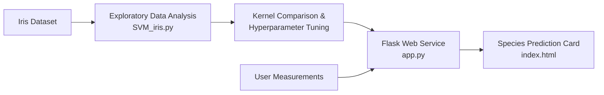

# 🌸 Iris Flower Species Classifier with Support Vector Machines (SVM)

[](https://www.python.org/)
[](https://flask.palletsprojects.com/)
[](https://scikit-learn.org/)
[](https://gunicorn.org/)
[](LICENSE)

An end-to-end Machine Learning web application that predicts Iris flower species (*Setosa*, *Versicolor*, *Virginica*) in real-time based on morphological sepal and petal dimensions using Support Vector Classification (SVC).

---

## 📌 Project Highlights

- **Supervised ML Classification:** Evaluates **Linear**, **RBF**, and **Polynomial** SVM kernels.
- **Hyperparameter Optimization:** Explores hyperparameter search spaces using both `GridSearchCV` and `RandomizedSearchCV`.
- **Interactive Web Interface:** Clean and responsive UI built with Flask, semantic HTML5, and custom CSS.
- **Production-Ready Packaging:** Includes `gunicorn` WSGI server configuration for one-click deployment.

---

## 🏗️ Architecture & Workflow



---

## 📊 Dataset & Features

The model is trained on the classic Fisher's Iris Dataset comprising 150 instances (50 per class) with four continuous features:

| Feature Name | Description | Units |
| :--- | :--- | :--- |
| `sepal-length` | Length of the sepals | Centimeters (cm) |
| `sepal-width` | Width of the sepals | Centimeters (cm) |
| `petal-length` | Length of the petals | Centimeters (cm) |
| `petal-width` | Width of the petals | Centimeters (cm) |

**Target Classes:**
- `Iris-setosa`
- `Iris-versicolor`
- `Iris-virginica`

---

## 🤖 Model Engineering & Hyperparameter Tuning

In `SVM_iris.py`, multiple kernel architectures and optimization strategies were evaluated:

1. **Kernel Architectures:**
   - **Linear Kernel (`kernel='linear', C=1, gamma=1`):** Effective for linearly separable subsets (Setosa vs others).
   - **Radial Basis Function (`kernel='rbf', C=1, gamma=1`):** Maps non-linear relationships in higher dimensions.
   - **Polynomial Kernel (`kernel='poly', C=0.1, gamma=0.1`):** Configured for the deployed web prediction service.

2. **Cross-Validation & Grid Search:**
   - Evaluated parameter grids across $C \in [0.001, 1000]$, $\gamma \in [0.0001, 1]$, and kernels `['linear', 'rbf', 'poly']` using 5-fold cross-validation (`cv=5`).

---

## 📂 Project Structure

```text
svm-iris-classifier/
├── .gitignore              # Ignores __pycache__, .venv, .env
├── .gitattributes          # Ensures GitHub Linguist classifies repo as Python
├── SVM_iris.py             # Model training, kernel comparison, & CV search
├── app.py                  # Flask web application & inference endpoint
├── iris_dataset.csv        # Iris training dataset
├── requirements.txt        # Application dependencies (Flask, scikit-learn, gunicorn)
├── static/
│   └── style.css           # Custom modern card interface stylesheet
└── templates/
    └── index.html          # Jinja2 template for user input & prediction result
```

---

## 🚀 Getting Started

### Prerequisites
- Python 3.9 or higher
- Git

### 1. Clone the Repository
```bash
git clone https://github.com/usha1101/svm-iris-classifier.git
cd svm-iris-classifier
```

### 2. Create and Activate a Virtual Environment
```bash
# Windows
python -m venv venv
.\venv\Scripts\activate

# macOS / Linux
python3 -m venv venv
source venv/bin/activate
```

### 3. Install Dependencies
```bash
pip install -r requirements.txt
```

### 4. Run the Web Application
```bash
python app.py
```

Open your browser and navigate to:  
`http://127.0.0.1:5000`

---

## 🌐 Production Deployment (Gunicorn / Cloud)

To run with Gunicorn in production:

```bash
gunicorn app:app --bind 0.0.0.0:8000
```

### Deploying to Render / Railway:
1. Push this repository to GitHub.
2. Link the repository to [Render](https://render.com) as a **Web Service**.
3. Set the **Build Command** to: `pip install -r requirements.txt`
4. Set the **Start Command** to: `gunicorn app:app`

---

## 👩‍💻 Author

**Ushashree M**  
- B.Tech Artificial Intelligence & Data Science, Reva University  
- GitHub: [@usha1101](https://github.com/usha1101)  

---

## 📄 License

This project is licensed under the [MIT License](LICENSE).
